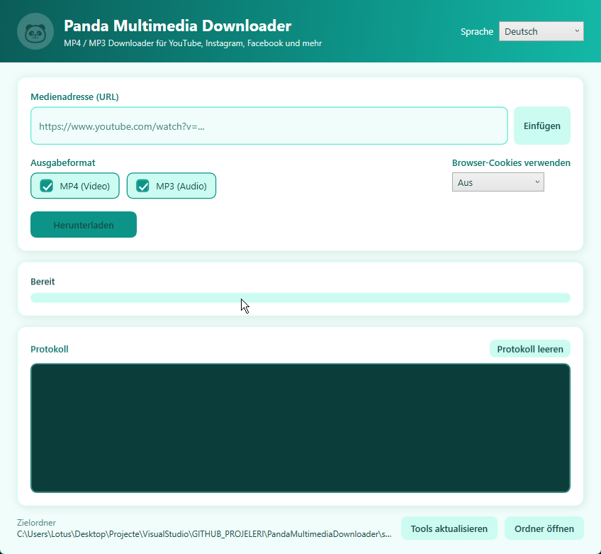

# 🐼 Panda Multimedia Downloader

A lightweight Windows desktop app (.NET 9 / WPF) that downloads videos from
YouTube, Instagram, Facebook and hundreds of other sites as **MP4**, **MP3**, or both.
Turquoise-themed UI, available in **Türkçe / Deutsch / English**.



## Features

- **One URL, one click.** Paste a link, pick MP4 and/or MP3, press Download.
- **MP4 + MP3 together.** When both are selected the MP3 is extracted from the
  downloaded MP4 with ffmpeg, so the media is fetched only once.
- **Sensible file names.** Files are named after the media title. If no title is
  available the name is derived from the URL, e.g. `youtube_dQw4w9WgXcQ` or
  `instagram_DavUIURsVSl`. Duplicates get `_2`, `_3`, ...
- **Output folder next to the app:** `downloaded/`.
- **Progress, speed and ETA**, a log panel and a cancel button.
- **Three languages**, switchable at runtime and remembered in `settings.json`.
- **Browser cookies option** for sites that require a login (private Instagram
  posts, some Facebook videos): Chrome, Edge, Firefox, Brave, Opera, Vivaldi.
- **Zero setup.** `yt-dlp`, `ffmpeg` and `deno` are downloaded automatically into
  `tools/` on first run. If `ffmpeg` is already on your `PATH`, it is reused.
- **Update tools** button re-downloads `yt-dlp` (sites change often; a stale
  `yt-dlp` is the most common cause of download errors).

## Supported sites

Everything supported by [yt-dlp](https://github.com/yt-dlp/yt-dlp/blob/master/supportedsites.md):
YouTube (videos, Shorts, Music), Instagram (posts, reels), Facebook (videos, reels,
fb.watch), TikTok, Twitter/X, Vimeo, Dailymotion, Twitch clips and many more.

## Getting started

Requirements: Windows 10/11, [.NET 9 SDK](https://dotnet.microsoft.com/download/dotnet/9.0).

```powershell
git clone https://github.com/kaplanerkan/PandaMultimediaDownloader.git
cd PandaMultimediaDownloader
dotnet run --project src/PandaMultimediaDownloader
```

### Ship it (no .NET required on the target machine)

```powershell
.\build.ps1
```

This runs a **self-contained** single-file publish (the .NET 9 runtime is embedded
in the exe) and downloads `yt-dlp`, `ffmpeg` and `deno` into `tools/`. Result:

```
dist/PandaMultimediaDownloader/
  PandaMultimediaDownloader.exe   ~57 MB, runtime included
  tools/yt-dlp.exe
  tools/ffmpeg.exe
  tools/deno.exe
dist/PandaMultimediaDownloader-v1.0.0-win-x64.zip
```

Copy the folder (or unzip) anywhere and run the exe. `downloaded/` and
`settings.json` are created next to it.

### Installer

```powershell
.\build.ps1 -Installer
```

Also produces `dist/PandaMultimediaDownloader-v1.0.0-win-x64-setup.exe`
(needs [Inno Setup 6](https://jrsoftware.org/isinfo.php): `winget install JRSoftware.InnoSetup`).
The setup installs per user into `%LOCALAPPDATA%\Programs\Panda Multimedia Downloader`
(no admin rights, the app can write its files next to the exe), adds a Start menu
entry and an optional desktop shortcut, and speaks Türkçe / Deutsch / English.
Uninstalling removes `tools/` and `settings.json` but keeps `downloaded/`.

Options: `.\build.ps1 -NoTools` skips the tool download (the app fetches them on
first run instead); plain `dotnet publish src/PandaMultimediaDownloader -c Release`
does the same as the script without zipping, `-p:DownloadTools=false` to opt out.

Pushing a `v*` tag builds the zip on GitHub Actions and attaches it to a release.

## Tests

```powershell
dotnet test
```

xUnit tests cover file-name derivation, sanitising, unique naming and localization.

## Project layout

```
src/PandaMultimediaDownloader/
  Localization/Loc.cs           TR / DE / EN strings, runtime language switch
  Services/ToolManager.cs       locates or downloads yt-dlp, ffmpeg, deno
  Services/DownloadService.cs   download pipeline, MP3 extraction, progress
  Services/FileNameHelper.cs    title / URL -> safe, unique file name
  Services/AppSettings.cs       settings.json persistence
  ViewModels/MainViewModel.cs   UI state and commands
  Themes/Turquoise.xaml         palette and control styles
tests/PandaMultimediaDownloader.Tests/
```

## Troubleshooting

| Symptom | What to do |
|---|---|
| "Sign in to confirm you're not a bot" / login required | Select your browser under **Use browser cookies** and retry. |
| Download fails right after a site update | Press **Update tools**. |
| First start takes a while | Only when `tools/` is missing: `yt-dlp` (~17 MB), `deno` (~90 MB) and, if not on `PATH`, `ffmpeg` are downloaded once. Builds from `build.ps1` ship them already. |

## Türkçe

YouTube, Instagram, Facebook ve yt-dlp'nin desteklediği diğer sitelerden medyayı
MP4, MP3 veya her ikisi olarak indiren .NET 9 / WPF uygulaması.

- URL yapıştır, format seç, **İndir**.
- Dosya adı medya başlığından gelir; başlık yoksa URL'den türetilir.
- Çıktı uygulamanın yanındaki `downloaded/` klasörüne yazılır.
- Dil: Türkçe / Deutsch / English, çalışırken değiştirilebilir.
- Oturum isteyen içerikler için **Tarayıcı çerezlerini kullan** seçeneği.
- `yt-dlp`, `ffmpeg`, `deno` ilk açılışta otomatik iner; hata alırsan önce
  **Araçları güncelle** dene.

## License

MIT
